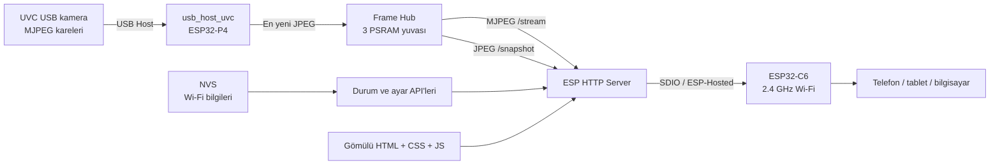

# ESP32-P4 Nano USB IP Webcam

Waveshare **ESP32-P4-NANO** kartına bağlanan standart bir USB UVC kamerayı, yerel ağdan erişilebilen bağımsız bir **MJPEG IP kameraya** dönüştüren gömülü sistem projesidir.

<p align="center">
  
  <br>
  <em>Yerel ağdaki 3D web paneli: yönelim, ivme/gyro ölçümleri ve canlı grafik</em>
</p>

USB kamera görüntüsü ESP32-P4 tarafından alınır, PSRAM üzerindeki düşük gecikmeli kare tamponuna aktarılır ve kartın üzerindeki ESP32-C6 Wi-Fi yardımcı işlemcisi aracılığıyla telefona, tablete veya bilgisayara yayınlanır. Canlı görüntüleme sayfası, stil dosyası ve JavaScript kodu doğrudan cihaz yazılımının içine gömülüdür; çalışması için Raspberry Pi, bilgisayar, bulut sunucusu veya ayrı bir uygulama gerekmez.

> Bu proje **Muhammed Fatih Şahin** tarafından **yapay zekâ destekli olarak geliştirilmiştir**.

## İçindekiler

- [Proje ne yapar?](#proje-ne-yapar)
- [Öne çıkan özellikler](#öne-çıkan-özellikler)
- [Sistem mimarisi](#sistem-mimarisi)
- [Çalışma mantığı](#çalışma-mantığı)
- [Donanım gereksinimleri](#donanım-gereksinimleri)
- [Yazılım ve bağımlılıklar](#yazılım-ve-bağımlılıklar)
- [Proje dizin yapısı](#proje-dizin-yapısı)
- [Kurulum ve derleme](#kurulum-ve-derleme)
- [Wi-Fi yapılandırması](#wi-fi-yapılandırması)
- [Kullanım](#kullanım)
- [Web arayüzü](#web-arayüzü)
- [HTTP API](#http-api)
- [Teknik ayrıntılar](#teknik-ayrıntılar)
- [Yapılandırma seçenekleri](#yapılandırma-seçenekleri)
- [Performans ve kaynak kullanımı](#performans-ve-kaynak-kullanımı)
- [Güvenlik notları](#güvenlik-notları)
- [Sorun giderme](#sorun-giderme)
- [Sınırlamalar](#sınırlamalar)
- [Geliştirme notları](#geliştirme-notları)

## Proje ne yapar?

Proje, kartın **USB Type-A** girişindeki UVC uyumlu kameradan gelen hazır JPEG karelerini alır ve bunları yeniden kodlamadan HTTP üzerinden yayınlar. Böylece ESP32-P4, kameranın görüntüsünü yerel ağda izlenebilen bir IP kamera akışına dönüştürür.

Temel kullanım senaryosu şöyledir:

1. USB kamera kartın Type-A girişine takılır.
2. Kart, kayıtlı 2.4 GHz Wi-Fi ağına bağlanır.
3. Tarayıcıdan kartın IP adresi veya `http://p4cam.local/` açılır.
4. Canlı görüntü izlenir; çözünürlük ve kare hızı tarayıcıdan değiştirilebilir.
5. İstenirse o anki kare JPEG dosyası olarak kaydedilir.
6. Wi-Fi bilgileri aynı arayüzden değiştirilip kalıcı hafızaya yazılabilir.

Ev ağına bağlantı kurulamazsa cihaz otomatik olarak **`P4-Webcam`** adlı bir kurulum erişim noktası açar. Bu ağa bağlanılarak cihazın arayüzü `http://192.168.4.1/` adresinden kullanılabilir.

## Öne çıkan özellikler

- ESP32-P4 üzerinde USB Host ve UVC kamera desteği
- UVC kameranın sunduğu **MJPEG** modlarını otomatik algılama
- Tarayıcı üzerinden canlı `multipart/x-mixed-replace` MJPEG akışı
- Kamera görüntüsünü yeniden sıkıştırmadan iletme
- Düşük gecikme için “kuyruk biriktirme, en yeni kareyi göster” yaklaşımı
- PSRAM üzerinde üç yuvalı, okuyucu güvenli kare tamponu
- En fazla **3 eşzamanlı canlı yayın izleyicisi**
- Kamera çözünürlüğünü ve FPS değerini çalışma sırasında değiştirme
- Tek kareyi JPEG olarak indirme
- Gerçek zamanlı FPS, veri hızı, izleyici sayısı, RSSI ve bağlantı durumu
- Wi-Fi ağı tarama ve tarayıcıdan ağ bilgisi kaydetme
- Bağlantı başarısız olduğunda otomatik kurulum ağı
- Wi-Fi bilgilerinin NVS kalıcı hafızasında saklanması
- İstasyon modunda mDNS ile `p4cam.local` erişimi
- İzleyici kalmadığında USB yayınını otomatik durdurarak kaynak tasarrufu
- Kamera çıkarma ve yeniden takma durumlarını yönetme
- Masaüstü ve mobil cihazlara uyumlu, cihaz içine gömülü web arayüzü

## Sistem mimarisi

Kart üzerindeki iki işlemcinin görevi birbirinden farklıdır:

- **ESP32-P4:** USB kamerayı, kare tamponlarını, HTTP sunucusunu, web arayüzünü ve uygulama mantığını çalıştırır.
- **ESP32-C6:** P4 için 2.4 GHz Wi-Fi bağlantısını sağlar. P4 ile C6 arasındaki iletişim SDIO ve ESP-Hosted üzerinden gerçekleşir.



### Ana veri yolu

```text
USB kamera
   │  MJPEG/UVC
   ▼
usb_camera.c
   │  geçerli JPEG kare
   ▼
frame_hub.c ──► en güncel kare + istatistikler
   │
   ├──► /stream   ──► sürekli MJPEG akışı
   └──► /snapshot ──► tek JPEG kare
```

Kamera JPEG ürettiği için cihaz tarafında pahalı bir görüntü kodlama işlemi yapılmaz. Gelen veri içindeki JPEG başlangıç işareti bulunur, kare uygun bir PSRAM yuvasına kopyalanır ve bekleyen yayın görevleri uyandırılır.

## Çalışma mantığı

### 1. Açılış sırası

`app_main()` uygulamayı aşağıdaki sırayla başlatır:

1. **NVS başlatılır.** NVS bölümünde sürüm veya boş alan sorunu varsa bölüm silinip yeniden hazırlanır.
2. **Frame Hub başlatılır.** PSRAM üzerinde kare yuvaları ayrılır.
3. **USB Host ve UVC sürücüsü başlatılır.** Wi-Fi kurulurken kamera algılama işlemi de çalışabilir.
4. **Wi-Fi yöneticisi başlatılır.** Önce kayıtlı veya derleme ayarındaki ev ağı denenir; başarısız olursa kurulum AP'si açılır.
5. **HTTP sunucusu başlatılır.** Web dosyaları, canlı akış, anlık görüntü ve JSON API uçları kaydedilir.
6. IP adresi, mDNS adı, ağ modu ve MAC adresi seri porta yazdırılır.

### 2. Kameranın algılanması ve mod seçimi

USB Host katmanı Type-A girişinde bir UVC aygıtı gördüğünde yalnızca UVC akış indeksi `0` kullanılır. Kameranın bildirdiği biçimler okunur, MJPEG olmayanlar elenir, aynı çözünürlük/FPS birleşimleri tekilleştirilir ve en fazla 24 mod saklanır.

Kamera MJPEG modu sunmuyorsa arayüzde `mjpeg_yok` durumu gösterilir. YUY2 gibi ham biçimler bu proje tarafından dönüştürülmez.

Başlangıçta yazılım ağa uygun bir modu puanlar. Tercih sırası yaklaşık 1280×720, 640×480, 800×600, 320×240 ve 1920×1080 şeklindedir; bu çözünürlüklerde yaklaşık **15 FPS** değerine yakın modlar öne çıkar. Büyük mod açılamazsa kameranın en küçük MJPEG modu denenir. Üç başarısız açma denemesinden sonra `acilamadi` hatası yayınlanır.

### 3. Karelerin işlenmesi

UVC sürücüsünde 3 adet, her biri en fazla 1 MiB olan PSRAM kare tamponu ile dahili RAM'de 4 adet 10 KiB URB kullanılır. Kamera callback'i ağır işlem yapmaz; kare işaretçisini FreeRTOS kuyruğuna bırakır. Kuyrukta birden fazla kare varsa eski kareler kameraya iade edilir ve yalnızca en yenisi işlenir. Bu davranış, ağ yavaşladığında gecikmenin sürekli büyümesini önler.

### 4. Frame Hub

Frame Hub, PSRAM'de önce **3 × 768 KiB** kare yuvası ayırmayı dener. Bellek yetersizse sırasıyla **3 × 384 KiB** ve **3 × 192 KiB** seçeneklerine geri düşer.

Yeni kare yayınlanırken:

1. İlk 64 bayt içinde JPEG başlangıç işareti (`FF D8`) aranır.
2. Geçersiz, çok küçük veya kapasiteden büyük kare atılır.
3. Yayındaki yuva dışında, okuyucusu olmayan bir yuva seçilir.
4. JPEG bu yuvaya kopyalanır ve artan sıra numarası atanır.
5. Canlı yayın bekleyen görevler FreeRTOS bildirimiyle uyandırılır.

Okuyucu bir kareyi kullanırken yuva kilitli sayılır; gönderim bittikten sonra serbest bırakılır. Frame Hub geçmiş kare kuyruğu tutmaz. Her istemci mevcut **en yeni kareyi** alır; yavaş bir istemci sınırsız gecikme oluşturmaz.

### 5. Canlı yayın ve boşta durdurma

`GET /stream` isteği her izleyici için ayrı FreeRTOS görevi oluşturur. Yanıt `multipart/x-mixed-replace; boundary=frame` biçimindedir ve her JPEG ayrı MIME parçası olarak gönderilir. `TCP_NODELAY` etkindir. En fazla üç izleyici kabul edilir; limit dolduğunda `503 Service Unavailable` döner.

Son izleyici ayrıldıktan yaklaşık **5 saniye** sonra UVC akışı durdurulur. Yeni izleyici geldiğinde otomatik başlar. Tarayıcı sekmesi arka plana geçtiğinde ön yüz de akışı kapatır ve sekme görünür olunca yeniden açar.

### 6. Wi-Fi davranışı

Wi-Fi bilgileri şu öncelikle seçilir:

1. NVS'de web arayüzünden kaydedilmiş bilgiler
2. `menuconfig` ile derlemeye yazılmış bilgiler
3. SSID boşsa doğrudan kurulum erişim noktası

İlk istasyon bağlantısı sekiz kez yeniden denenir. Başarısız olursa `P4-Webcam` erişim noktası açılır. Cihaz daha önce başarıyla ev ağına bağlandıysa sonradan kopma durumunda AP'ye dönmek yerine aynı ağa yeniden bağlanmayı sürdürür.

## Donanım gereksinimleri

| Bileşen | Gereksinim / açıklama |
| --- | --- |
| Geliştirme kartı | Waveshare ESP32-P4-NANO |
| Kamera | USB Video Class (UVC) ve MJPEG çıkışı destekleyen USB kamera |
| Kamera bağlantısı | Kart üzerindeki USB Type-A Host girişi |
| Programlama bağlantısı | USB Type-C kablo |
| Güç kaynağı | Kamera tüketimine bağlı olarak kararlı 5 V / 2 A veya üzeri önerilir |
| Kablosuz ağ | 2.4 GHz Wi-Fi; ESP32-C6 üzerinden sağlanır |
| İstemci | MJPEG gösterebilen güncel bir web tarayıcısı |

| Fiziksel bağlantı | Görevi |
| --- | --- |
| USB Type-C | Kartı besleme, firmware yükleme ve seri log |
| USB Type-A | UVC kamerayı bağlama |
| ESP32-C6 | Kart üzerindeki Wi-Fi yardımcı işlemcisi |

> Kamera mutlaka **Type-A Host** girişine bağlanmalıdır. Type-C bağlantısı kamera girişi değildir.

## Yazılım ve bağımlılıklar

Proje ESP-IDF bileşen yöneticisini kullanır. Temel bağımlılıklar `main/idf_component.yml` dosyasında tanımlıdır.

| Bileşen | Görevi |
| --- | --- |
| ESP-IDF | FreeRTOS, ağ, NVS, HTTP ve donanım altyapısı |
| `espressif/usb_host_uvc` | UVC algılama, mod sorgulama ve MJPEG kare alma |
| `espressif/usb` | USB Host altyapısı |
| `espressif/esp_hosted` | P4 ile C6 arasındaki bağlantı |
| `espressif/esp_wifi_remote` | C6 Wi-Fi'sini P4 üzerinden kullanma |
| `espressif/mdns` | `p4cam.local` yerel ağ adı |
| `esp_http_server` | Web arayüzü, MJPEG yayın ve JSON API |
| NVS | Wi-Fi SSID/parolasını kalıcı saklama |
| PSRAM / heap API | Büyük JPEG tamponlarını harici RAM'de tutma |

Manifest en az ESP-IDF 5.4 tanımlasa da güncel kilit dosyasındaki USB bileşeni **ESP-IDF 5.5.3 veya üzerini** gerektirir. Mevcut `dependencies.lock` çözümü ESP-IDF **6.1.0** ile oluşturulmuştur. En az 5.5.3, mümkünse kilit dosyasıyla uyumlu sürüm önerilir.

## Proje dizin yapısı

```text
esp-p4-nano-usb-ip-webcam/
├── CMakeLists.txt                    Proje tanımı
├── partitions.csv                    NVS, PHY ve 4 MiB uygulama bölümleri
├── sdkconfig.defaults                Ortak FreeRTOS, PSRAM, USB ve ağ ayarları
├── sdkconfig.defaults.esp32p4        P4, C6, SDIO ve Wi-Fi tampon ayarları
├── config/
│   └── esp32p4_rev_v1.defaults       Eski P4 silikon revizyonu ayarları
└── main/
    ├── CMakeLists.txt                Kaynaklar ve gömülü web dosyaları
    ├── idf_component.yml             Harici bileşen bağımlılıkları
    ├── Kconfig.projbuild             menuconfig seçenekleri
    ├── config.h                      Sabitler ve limitler
    ├── text_util.h                   Metin/JSON/FPS yardımcıları
    ├── app_main.c                    Sistem açılış sırası
    ├── camera/usb_camera.c           USB Host, UVC ve kamera durum makinesi
    ├── net/wifi_manager.c            STA/AP, yeniden bağlanma, tarama ve mDNS
    ├── net/nvs_store.c               Wi-Fi bilgisini kalıcı saklama
    ├── stream/frame_hub.c            En yeni JPEG kareyi dağıtan tampon
    ├── stream/http_server.c          Statik dosya, MJPEG ve snapshot sunucusu
    ├── stream/http_api.c             Durum, format ve Wi-Fi JSON uçları
    └── web/
        ├── index.html                Türkçe kullanıcı arayüzü
        ├── app.css                   Koyu tema ve mobil görünüm
        └── app.js                    Akış, kamera ve Wi-Fi kontrolleri
```

`main/web` dosyaları CMake `EMBED_FILES` ile firmware içine alınır. Değişiklikten sonra proje yeniden derlenip yüklenmelidir.

## Kurulum ve derleme

### 1. ESP-IDF ortamını hazırlayın

ESP-IDF 5.5.3 veya daha yeni bir sürüm kurun ve **ESP-IDF PowerShell** terminalini açın. Resmî adımlar için [ESP32-P4 başlangıç kılavuzuna](https://docs.espressif.com/projects/esp-idf/en/stable/esp32p4/get-started/index.html) bakabilirsiniz.

### 2. Proje klasörüne geçin ve hedefi seçin

```powershell
cd C:\path\to\esp-p4-nano-usb-ip-webcam
idf.py set-target esp32p4
```

### 3. İsteğe bağlı yapılandırmayı açın

```powershell
idf.py menuconfig
```

**P4 USB Webcam** menüsünden Wi-Fi, kurulum ağı, HTTP portu ve mDNS ayarlarını düzenleyin.

### 4. Derleyin, yükleyin ve seri çıktıyı açın

```powershell
idf.py build
idf.py flash monitor
```

Birden fazla seri cihaz varsa:

```powershell
idf.py -p COM5 flash monitor
```

İlk derleme internet ister; bileşen yöneticisi bağımlılıkları indirir. Seri monitörden ESP-IDF'nin standart `Ctrl+]` kısayoluyla çıkılır.

Başarılı açılışta yaklaşık şu bilgiler görülür:

```text
----------------------------------------
ESP32-P4 Nano USB webcam hazir
Ev agi       : <ağ-adı>
Site         : http://192.168.1.23/
Kisayol      : http://p4cam.local/
MAC          : XX:XX:XX:XX:XX:XX
Kamera       : karttaki Type-A USB girisi
----------------------------------------
```

### Eski ESP32-P4 silikon revizyonları

Varsayılan profil güncel P4 silikonunu hedefler. Logda örneğin `chip revision: v1.3` görülüyor ve uygulama revizyon uyuşmazlığıyla başlamıyorsa:

```powershell
idf.py fullclean
Remove-Item -LiteralPath sdkconfig -ErrorAction SilentlyContinue
idf.py -D SDKCONFIG_DEFAULTS="sdkconfig.defaults;sdkconfig.defaults.esp32p4;config/esp32p4_rev_v1.defaults" set-target esp32p4
idf.py build flash monitor
```

## Wi-Fi yapılandırması

### Yöntem A — Tarayıcıdan kurulum

Derleme ayarındaki SSID boşsa veya ağa sekiz denemede bağlanılamazsa cihaz şu ağı açar:

- SSID: `P4-Webcam`
- Varsayılan parola: `p4webcam1`
- Adres: `http://192.168.4.1/`

Bu ağa bağlanın, cihaz sayfasını açın ve **Ev ağını değiştir** bölümünden 2.4 GHz ağ bilgilerini kaydedin. Cihaz bilgiyi NVS'ye yazar, yaklaşık 400 ms sonra yeniden başlar ve yeni ağa bağlanır. Telefonun “bu ağda internet yok” uyarısı normaldir.

### Yöntem B — Derleme öncesi menuconfig

```powershell
idf.py menuconfig
```

**P4 USB Webcam** menüsünde ev ağı adı/parolası, kurulum ağı parolası, HTTP portu ve mDNS adı ayarlanır. Web arayüzünden NVS'ye kaydedilen bilgiler bunlardan önceliklidir.

### Kayıtlı ağı sıfırlama

Projede ayrı bir “Wi-Fi bilgisini unut” API'si yoktur. NVS dahil bütün flaşı silip firmware'i tekrar yüklemek için:

```powershell
idf.py erase-flash
idf.py flash monitor
```

> `erase-flash` cihazdaki tüm kalıcı verileri ve firmware'i siler.

## Kullanım

1. Kartı kararlı bir güç kaynağına bağlayın.
2. MJPEG destekli UVC kamerayı Type-A girişine takın.
3. Seri monitörde yazan IP adresini açın.
4. İstasyon modunda `http://p4cam.local/` adresini de deneyebilirsiniz.
5. Arayüzden çözünürlük ve FPS seçin.
6. **Durdur / İzle** ile kendi yayın bağlantınızı yönetin.
7. **Tam ekran** düğmesini veya görüntüye çift tıklamayı kullanın.
8. **Fotoğraf kaydet** ile güncel kareyi `p4-kare.jpg` olarak indirin.

Arayüzde yalnızca kameranın bildirdiği MJPEG modları görünür. Çözünürlük seçilince 20 FPS veya altındaki en yüksek değer; bu yoksa en düşük değer tercih edilir. Ölçülen hız 7 Mb/s üzerine çıkınca arayüz daha düşük çözünürlük önerir.

## Web arayüzü

Arayüz saf HTML, CSS ve JavaScript'tir; CDN veya dış kütüphane kullanmaz. SSID, IP, kamera çözünürlüğü, ölçülen FPS, veri hızı, izleyici sayısı, RSSI ve kamera durumu gösterilir.

Otomatik davranışlar:

- Durum API'si saniyede bir sorgulanır.
- Kamera bağlanınca desteklenen biçimler yüklenir.
- Akış dört saniyede görünmezse istemci URL'yi yeniler.
- Sekme gizlenince yayın bağlantısı kapanır.
- Sekme yeniden görünür olduğunda kullanıcı elle durdurmadıysa yayın açılır.
- Kamera hazır değilse veya hata bildirdiyse akış başlatılmaz.

## HTTP API

Sunucu varsayılan olarak port `80` üzerinde çalışır. Kimlik doğrulama veya TLS yoktur.

| Yöntem | Yol | Açıklama |
| --- | --- | --- |
| `GET` | `/` | Gömülü kullanıcı arayüzü |
| `GET` | `/app.css` | Gömülü stil dosyası |
| `GET` | `/app.js` | Gömülü ön yüz kodu |
| `GET` | `/stream` | Sürekli MJPEG canlı yayın |
| `GET` | `/snapshot` | En güncel kareyi `image/jpeg` döndürür |
| `GET` | `/api/status` | Wi-Fi, kamera ve kare merkezi durumu |
| `GET` | `/api/formats` | Kameranın MJPEG modları |
| `POST` | `/api/format` | Çözünürlük/FPS değiştirir |
| `GET` | `/api/wifi/scan` | Yakındaki görünür ağları tarar |
| `POST` | `/api/wifi` | Wi-Fi bilgisini kaydedip cihazı yeniden başlatır |

### `GET /api/status`

```json
{
  "uptime_s": 125,
  "wifi": {
    "mode": "sta",
    "ssid": "OrnekAg",
    "ip": "192.168.1.23",
    "rssi": -52,
    "hostname": "p4cam",
    "connected": true
  },
  "camera": {
    "connected": true,
    "streaming": true,
    "width": 1280,
    "height": 720,
    "fps_x10": 150,
    "error": "",
    "frames": 1845,
    "overflows": 0
  },
  "hub": {
    "fps_x10": 149,
    "kbps": 3150,
    "viewers": 1,
    "dropped": 0,
    "published": 1845
  }
}
```

`fps_x10` onda bir FPS birimindedir; `149`, 14.9 FPS demektir. Kamera hata kodları `mjpeg_yok` (MJPEG biçimi yok) ve `acilamadi` (UVC akışı açılamadı) olabilir.

### `GET /api/formats`

```json
{
  "formats": [
    { "w": 640, "h": 480, "fps": 15.0 },
    { "w": 1280, "h": 720, "fps": 15.0 }
  ]
}
```

Liste en fazla 24 benzersiz MJPEG çözünürlük/FPS birleşimi içerir.

### `POST /api/format`

```http
POST /api/format
Content-Type: application/json

{"width":1280,"height":720,"fps":15}
```

Başarılı yanıt:

```json
{"ok":true,"width":1280,"height":720,"fps":15.0}
```

FPS verilmezse yaklaşık 15 FPS hedeflenir. İstenen çözünürlük mevcutsa hedef FPS'e en yakın mod seçilir. Sonuçlar: geçersiz istek için `400`, bulunmayan çözünürlük için `404`, hazır olmayan kamera için `409`, uygulanamayan biçim için `500`.

### `GET /api/wifi/scan`

```json
{
  "ok": true,
  "networks": [
    { "ssid": "OrnekAg", "rssi": -48, "secure": true }
  ]
}
```

En fazla 12 benzersiz görünür ağ güçlüden zayıfa sıralanır. Aynı SSID birden fazla erişim noktasından görülürse en güçlü kayıt tutulur.

### `POST /api/wifi`

```http
POST /api/wifi
Content-Type: application/json

{"ssid":"OrnekAg","password":"ornek-parola"}
```

SSID zorunlu ve en fazla 32 karakterdir. Parola boş olabilir; boş değilse 8–63 karakter olmalıdır. Başarılı istek bilgiyi NVS'ye yazar ve cihazı yeniden başlatır.

## Teknik ayrıntılar

### FreeRTOS görevleri ve çekirdek kullanımı

| Görev | Çekirdek | Öncelik | Yığın | Görevi |
| --- | ---: | ---: | ---: | --- |
| USB kütüphane görevi | 1 | 17 | 4096 bayt | USB Host olayları |
| UVC sürücü arka plan görevi | 1 | 18 | 6 KiB | Kamera sürücüsü olayları |
| Kamera görevi | 1 | 14 | 8192 bayt | Kare kuyruğu, mod ve akış yaşam döngüsü |
| HTTP sunucusu | 0 | IDF varsayılanı | 8192 bayt | Sayfa ve API istekleri |
| Her yayın istemcisi | 0 | 5 | 6144 bayt | MJPEG istemcisine kare gönderme |

USB/kamera işleri çekirdek 1'de, HTTP ve istemci akışları çekirdek 0'da çalışır.

### Eşzamanlılık ve format değiştirme

- Kamera durumu ve mod listesi mutex ile korunur.
- Format değişiklikleri ayrı mutex ile sıraya alınır.
- İstek kamera görevine tek elemanlı kuyrukla iletilir.
- Frame Hub yuva/sayaçları kısa kritik bölgelerle korunur.
- Her izleyici yeni karede görev bildirimi alır.
- Callback bloklanmaz; kuyruk doluysa kare işlenmez.

Format değişiminde kare kabulü durur, kuyruktaki kareler sürücüye döner, yeni UVC biçimi seçilir ve alım yeniden açılır. Format kilidi için 3.5 saniye, işlemin bitmesi için 3 saniye zaman aşımı vardır.

### İstatistikler

Hub yaklaşık bir saniyelik pencerede yayınlanan karelerden FPS, JPEG baytlarından kbps hesaplar. Son 1.5 saniyede kare yoksa iki değer sıfırdır. `camera.frames` başarıyla yayınlanan kareleri, `hub.dropped` geçersiz/büyük/yazılamayan kareleri, `camera.overflows` UVC overflow/underflow olaylarını sayar.

### HTTP sunucu ayarları

- En fazla 7 açık soket ve 12 URI işleyicisi
- LRU soket temizleme kapalı
- 10 saniye alma, 8 saniye gönderme zaman aşımı
- Statik dosyalarda `Cache-Control: no-store`
- Akışta `no-cache`, `no-store` ve `Pragma: no-cache`

LRU temizleme kapalıdır; yeni kısa API isteklerinin aktif video soketini düşürmesi engellenir.

### Bölüm tablosu

| Bölüm | Başlangıç | Boyut | Kullanım |
| --- | ---: | ---: | --- |
| `nvs` | `0x9000` | `0x6000` | Wi-Fi bilgileri ve NVS verisi |
| `phy_init` | `0xF000` | `0x1000` | PHY başlatma verisi |
| `factory` | `0x10000` | `0x400000` | 4 MiB uygulama görüntüsü |

Flaş boyutu 16 MiB seçilidir. Mevcut tabloda OTA bölümü yoktur; firmware seri bağlantıyla yüklenir.

## Yapılandırma seçenekleri

### `menuconfig` seçenekleri

| Seçenek | Varsayılan | Açıklama |
| --- | --- | --- |
| `CONFIG_WEBCAM_WIFI_SSID` | Proje ayarı | 2.4 GHz ev ağı; boşsa kurulum AP'si |
| `CONFIG_WEBCAM_WIFI_PASSWORD` | Proje ayarı | Ev ağı parolası; açık ağ için boş |
| `CONFIG_WEBCAM_AP_PASSWORD` | `p4webcam1` | 8 karakterden kısaysa AP açık olur |
| `CONFIG_WEBCAM_HTTP_PORT` | `80` | HTTP portu |
| `CONFIG_WEBCAM_HOSTNAME` | `p4cam` | mDNS adı |

### `main/config.h` sabitleri

| Sabit | Değer | Açıklama |
| --- | ---: | --- |
| `FRAME_SLOT_COUNT` | 3 | Hub yuva sayısı |
| `FRAME_SLOT_BYTES` | 768 KiB | Tercih edilen JPEG yuva kapasitesi |
| `FRAME_MAX_VIEWERS` | 3 | Eşzamanlı izleyici limiti |
| `CAM_MAX_MODES` | 24 | Azami kamera modu |
| `CAM_USB_BUFFERS` | 3 | UVC kare tamponu sayısı |
| `WIFI_STA_RETRIES` | 8 | İlk bağlantı deneme sayısı |
| `WIFI_AP_SSID` | `P4-Webcam` | Kurulum ağı adı |
| `WIFI_AP_CHANNEL` | 6 | Kurulum ağı kanalı |
| `WIFI_AP_MAX_CLIENTS` | 4 | AP istemci limiti |
| `CAM_IDLE_STOP_US` | 5 saniye | İzleyicisiz UVC durdurma süresi |

### ESP32-P4 / ESP32-C6 SDIO bağlantısı

| Sinyal | GPIO |
| --- | ---: |
| CLK | 18 |
| CMD | 19 |
| D0 | 14 |
| D1 | 15 |
| D2 | 16 |
| D3 | 17 |
| C6 reset | 54 |

4-bit SDIO saat hızı 40 MHz'tir. Bu profil Waveshare ESP32-P4-NANO içindir; farklı P4 kartlarında pinler değiştirilmelidir.

## Performans ve kaynak kullanımı

Varsayılan büyük tamponlar yaklaşık 2.25 MiB Frame Hub (`3 × 768 KiB`) ve 3 MiB UVC kare alanı (`3 × 1 MiB`) ister. Buna görev yığınları, URB'ler, ağ tamponları ve sürücü verileri eklenir. Büyük ayırmalar PSRAM'e yönlendirilirken dahili RAM'de 64 KiB rezerv bırakılır.

Projenin hedefi her kareyi eksiksiz teslim etmek değil, **en güncel görüntüyü düşük gecikmeyle** göstermektir. Eski kareler atlanabilir, Hub geçmiş tutmaz, yavaş izleyici diğerlerine kuyruk oluşturmaz ve boş yuva yoksa kare düşürülebilir. Bu yaklaşım canlı izleme için uygundur; eksiksiz video arşivleme için uygun değildir.

Akıcılığı iyileştirmek için:

- Önce 640×480 veya 1280×720, 10–20 FPS deneyin.
- Kartı erişim noktasına yakın tutun.
- Kaliteli USB bağlantısı ve güçlü 5 V kaynak kullanın.
- 768 KiB'yi aşan karelerde çözünürlüğü düşürün.
- Gereksiz açık yayın sekmelerini kapatın.

## Güvenlik notları

Bu proje güvenilen yerel ağ kullanımı için tasarlanmıştır.

- Kullanıcı doğrulaması ve HTTPS/TLS yoktur.
- Ağa erişebilen biri görüntüyü açabilir, snapshot alabilir, kamera modunu veya Wi-Fi ayarını değiştirebilir.
- Wi-Fi parolası NVS içinde uygulama düzeyinde ayrıca şifrelenmez.
- `menuconfig` ile girilen bilgiler firmware'e dahil olabilir.
- Kurulum AP parolasını varsayılan değerde bırakmayın.
- Cihazı doğrudan internete açmayın ve port yönlendirme yapmayın.
- Projeyi paylaşmadan önce kaynaklarda, `sdkconfig` içinde ve sürüm geçmişinde gerçek ağ bilgilerinin bulunmadığını kontrol edin.

Uzaktan erişim gerekiyorsa güvenilir VPN, ayrı ağ segmenti ve uygulama düzeyinde kimlik doğrulama önerilir.

## Sorun giderme

| Belirti | Kontrol / çözüm |
| --- | --- |
| Kamera hiç görünmüyor | Type-A girişini, UVC uyumluluğunu ve güç kaynağını kontrol edin. |
| “MJPEG vermiyor” | Kamera yalnızca YUY2 gibi ham format sunuyor olabilir; MJPEG destekli kamera gerekir. |
| Kamera açılmıyor | Kamerayı yeniden takın, gücü kontrol edin ve seri logdaki ESP hata adını inceleyin. |
| Kare tamponu küçük | Daha düşük çözünürlük seçin veya `FRAME_SLOT_BYTES` değerini artırın. |
| Görüntü takılıyor | FPS/çözünürlük ve izleyici sayısını düşürün; RSSI, `dropped` ve `overflows` değerlerine bakın. |
| Ev ağına bağlanmıyor | 2.4 GHz, SSID, parola ve sinyal gücünü kontrol edin; kurulum AP'sinden yeniden kaydedin. |
| `p4cam.local` açılmıyor | Bazı ağlar mDNS çözmez; seri monitördeki IPv4 adresini kullanın. |
| `P4-Webcam` görünmüyor | Kart ev ağına bağlanmış olabilir; logu kontrol edin veya flaşı silip yeniden yükleyin. |
| Sayfa var, video yok | `/api/status` ve `/snapshot` deneyin; üç izleyici limiti dolmuş olabilir. |
| Bağımlılık derlenmiyor | ESP-IDF 5.5.3+ kullanın; interneti kontrol edip temiz derleme yapın. |
| Revizyon hatası | Rev 1.x kartta özel varsayılan dosyasını kullanın. |

RSSI yorumlaması: `-55 dBm` ve üzeri çok iyi, `-67 dBm` ve üzeri iyi, `-75 dBm` ve üzeri orta, daha düşük değer zayıftır.

## Sınırlamalar

- Yalnızca UVC **MJPEG** biçimi desteklenir.
- Video kaydı, ses, hareket algılama ve bulut yükleme yoktur.
- H.264/H.265, WebRTC, RTSP ve ONVIF yoktur.
- En fazla üç MJPEG izleyici vardır.
- Yalnızca UVC akış indeksi `0` kullanılır.
- HTTPS ve kullanıcı doğrulaması yoktur.
- Wi-Fi yalnızca 2.4 GHz'dir.
- Captive portal yönlendirmesi yoktur; adres elle açılır.
- OTA ve web üzerinden firmware güncelleme yoktur.
- Kare geçmişi tutulmaz; sistem video kayıt cihazı değildir.
- Varsayılan tek JPEG limiti 768 KiB'dir.
- Pozlama, netlik, zoom ve parlaklık gibi UVC kontrolleri uygulanmamıştır.

## Geliştirme notları

### Web arayüzünü değiştirme

`main/web/index.html`, `main/web/app.css` veya `main/web/app.js` düzenlendikten sonra:

```powershell
idf.py build flash
```

çalıştırılmalıdır; dosyalar çalışma zamanında dosya sisteminden okunmaz.

### Limitleri değiştirme

İzleyici sayısı, tampon boyutu ve boşta durdurma süresi `main/config.h` içindedir. İzleyici limitini artırırken her istemcinin ayrı görev yığını, HTTP soketi ve bant genişliği kullandığını; HTTP `max_open_sockets` değerinin 7 olduğunu hesaba katın.

### Yeni API ekleme

JSON uçları `main/stream/http_api.c`, statik/akış uçları `main/stream/http_server.c` içindedir. `max_uri_handlers` değeri 12 olduğundan yeni uçlarda limit artırılabilir.

### Temiz derleme

```powershell
idf.py fullclean
idf.py reconfigure
idf.py build
```

### Seri log etiketleri

| Etiket | Kaynak | Alan |
| --- | --- | --- |
| `app` | `app_main.c` | Açılış özeti |
| `wifi` | `wifi_manager.c` | STA/AP, IP, yeniden bağlantı |
| `nvs` | `nvs_store.c` | Kalıcı ağ bilgisi |
| `cam` | `usb_camera.c` | UVC, modlar ve kareler |
| `hub` | `frame_hub.c` | PSRAM ve büyük kareler |
| `http` | `http_server.c` | Sunucu ve gömülü sayfa |

---

**Geliştirici:** Muhammed Fatih Şahin  
**Geliştirme yaklaşımı:** Yapay zekâ destekli gömülü sistem ve web yazılımı geliştirme
